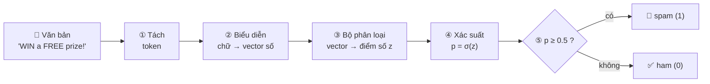
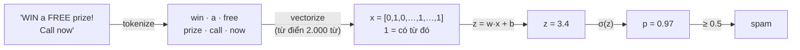
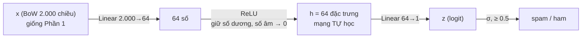
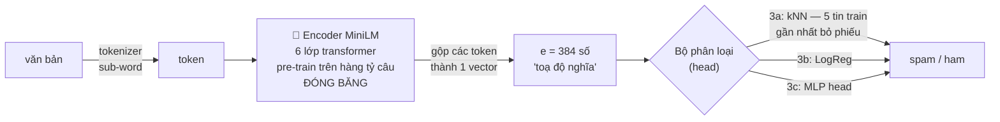
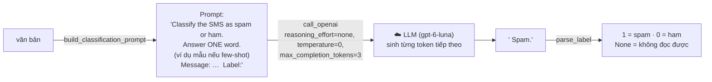
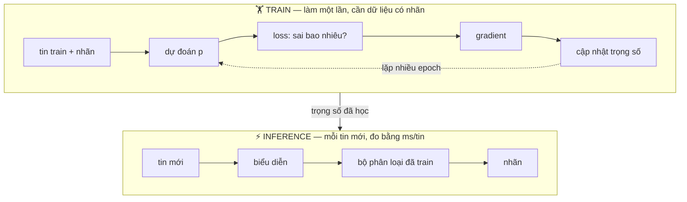

# Bài thực hành Ngày 1 — Một bài toán, bốn thế hệ AI: Lọc tin nhắn rác (Spam / Ham)

> **Hình thức: CÁ NHÂN** · **Thời lượng:** 2h30 trên Google Colab · **Deadline:** 23h59 (GMT+7) ngày lab, trừ khi coach thông báo khác
> **Cần có:** tài khoản GitHub + Google, OpenAI API key cho Phần 4 (không có key vẫn làm được Phần 0–3)
> **Đọc theo thứ tự:** README → [RULES](RULES.md) → [CHECKPOINTS](CHECKPOINTS.md) → [SUBMISSION](SUBMISSION.md) → [RUBRIC](RUBRIC.md)

<a href="https://colab.research.google.com/github/VinUni-AI20k/K5-L3-Day-01-AI-Foundation-Lab/blob/main/src/day01_spam_ml_dl_embedding_llm.ipynb" target="_blank" rel="noopener noreferrer"></a>

[Mở notebook `day01_spam_ml_dl_embedding_llm.ipynb` trên Colab](https://colab.research.google.com/github/VinUni-AI20k/K5-L3-Day-01-AI-Foundation-Lab/blob/main/src/day01_spam_ml_dl_embedding_llm.ipynb)

> **Bài nộp:** repository GitHub `K5-L3-DAY01-HoVaTen-MSSV-AIFoundation` có thư mục `report/individual/`; chỉ nộp **link repo** trên LMS (chi tiết: [SUBMISSION.md](SUBMISSION.md)).

Bạn giải **cùng một bài toán** là phân loại SMS thành `spam` hay `ham` (tin bình thường) bằng **4 cách**, theo đúng
lịch sử AI trong slide Ngày 1. Cuối bài, bạn so sánh 4 cách trên cùng một tập test về chất lượng, tốc độ và chi phí.

```text
Machine Learning  →  Deep Learning  →  Embedding           →  LLM
người chọn feature   mạng tự học        mượn encoder           không train,
máy học trọng số     đặc trưng          pre-train + gắn "đầu"  chỉ cần prompt
                                        phân loại lên trên
```

| Phần | Thời gian | Cách tiếp cận | Bạn tự làm gì |
| --- | --- | --- | --- |
| 0 | 0:00 – 0:10 | Cài đặt, khám phá dữ liệu | Tìm tin trùng lặp, hiểu vì sao accuracy dễ đánh lừa |
| 1 | 0:10 – 0:40 | **Machine Learning** | Bag-of-words + logistic regression **từ đầu bằng numpy** + precision/recall/F1 |
| 2 | 0:40 – 1:05 | **Deep Learning** | Mạng MLP + vòng lặp huấn luyện PyTorch, nhận diện overfitting |
| 3 | 1:05 – 1:30 | **Embedding** | Cosine, tìm kiếm theo nghĩa, kNN trên vector của encoder `all-MiniLM-L6-v2` |
| — | 1:30 – 1:35 | Nghỉ | |
| 4 | 1:35 – 2:05 | **LLM** | `call_openai` (đúng chữ ký template LLM API), prompt zero/few-shot, đo chi phí |
| 5 | 2:05 – 2:30 | Tổng hợp | Bảng so sánh, **biểu đồ đánh đổi 1 − F1 ↔ độ trễ**, **stress test 50 case khó**, thử thách cá nhân, nộp bài |

## Mục tiêu học tập

Sau bài thực hành, bạn có thể:

1. Giải thích máy "học" thế nào: feature → trọng số → loss → gradient descent, và tự viết được vòng lặp đó.
2. Chọn đúng thước đo khi dữ liệu lệch lớp (accuracy vs precision / recall / F1) và nhận ra data leakage.
3. Giải thích vì sao deep learning không phải lúc nào cũng thắng, và đọc được dấu hiệu overfitting.
4. Giải thích embedding là gì, vì sao nó tổng quát hoá tốt hơn bag-of-words với câu "ngụy trang".
5. Dùng LLM cho một downstream task: thiết kế prompt, đọc output không chắc chắn, ước tính chi phí theo token.
6. Chọn phương án cho sản phẩm thật dựa trên số đo (F1, thời gian train, throughput, latency p50/p95, USD/1k tin) và đường Pareto (1 − F1) ↔ độ trễ, không dựa trên cảm giác.
7. Kiểm tra độ bền của model trên các case đánh lừa (spam giọng tự nhiên, thao túng, né từ khoá, prompt injection) và đề xuất cách phòng thủ.

## Bản chất: từ văn bản đến nhãn, mỗi cách làm gì?

Máy tính không đọc được chữ, nó chỉ tính được với **số**. Vì vậy mọi cách lọc spam trong bài đều đi qua cùng
một khung. Bốn thế hệ AI chỉ khác nhau ở chỗ **ai làm bước nào** và **bước nào được học từ dữ liệu**.



| Bước | Machine Learning (Phần 1) | Deep Learning (Phần 2) | Encoder (Phần 3) | LLM (Phần 4) |
| --- | --- | --- | --- | --- |
| ① Tách token | tách theo từ | tách theo từ | tách thành sub-word (WordPiece) | tách thành token của GPT |
| ② Biểu diễn | **người** chọn: từ điển 2.000 từ, có/không (0/1) | như ML | **mượn** encoder pre-train → vector 384 chiều theo *nghĩa* | LLM tự đọc cả prompt |
| ③ Bộ phân loại | `z = w·x + b` (1 lớp) | mạng có hidden layer, **tự học** đặc trưng | kNN / LogReg / MLP gắn lên trên | LLM **sinh ra chữ** `spam` / `ham` |
| ④–⑤ Ra nhãn | σ rồi so ngưỡng 0.5 | σ rồi so ngưỡng 0.5 | bỏ phiếu, hoặc σ rồi so ngưỡng | đọc chữ trả về (`parse_label`) |
| **Học từ dữ liệu có nhãn** | trọng số `w`, `b` | toàn bộ mạng | chỉ phần bộ phân loại (encoder giữ nguyên) | không học gì, chỉ viết prompt |

### Theo chân một tin nhắn qua từng cách

Cùng một tin `"WIN a FREE prize! Call now"`. Các con số dưới đây chỉ là **minh hoạ**, không phải kết quả thật của bạn.

#### 1️⃣ Machine Learning: người chọn feature, máy học trọng số



- **Bản chất:** mỗi từ có một **trọng số** học được. Ví dụ `free` = +1.5 và `call` = +1.4 kéo về spam, còn
  `lunch` = −1.2 kéo về ham. Điểm `z` là tổng trọng số của các từ có trong tin, cộng thêm `b`.
- **Học thế nào:** đoán `p`, đo sai bằng loss, tính gradient, rồi chỉnh `w` ngược chiều gradient. Lặp lại 300 lần
  (gradient descent).
- **Điểm yếu:** chỉ thấy **từ có trong từ điển**. "complimentary holiday" không có trong từ điển nên mô hình không
  "thấy" gì, dù nghĩa giống "free prize".
- **Trong notebook:** `tokenize` → `build_vocab` → `vectorize` → `train_logreg` → `predict_proba`.

#### 2️⃣ Deep Learning: mạng tự học đặc trưng



- **Bản chất:** thêm một **hidden layer** đứng giữa. Mỗi nơ-ron ẩn tự học một **tổ hợp từ**. Ví dụ một nơ-ron
  chỉ "sáng" khi `free` + `call` + số điện thoại cùng xuất hiện. Đây là điều LogReg không làm được, vì LogReg chỉ cộng
  từng từ riêng lẻ.
- **ReLU là gì:** hàm phi tuyến (giữ số dương, đổi số âm thành 0). Nếu bỏ ReLU thì 2 lớp Linear liên tiếp gộp lại
  chỉ còn 1 lớp Linear, tức là lại thành logistic regression.
- **Vẫn cần:** dữ liệu có nhãn, và **vẫn dùng BoW** làm đầu vào. Mạng học được tổ hợp từ, nhưng vẫn không hiểu
  từ đồng nghĩa.
- **Trong notebook:** `vectorize` → `build_mlp` → `train_mlp` (forward → loss → backward → `opt.step()`) →
  `predict_mlp`.

#### 3️⃣ Encoder: mượn "bản đồ nghĩa" đã được pre-train



- **Bản chất:** encoder **không** phân loại spam. Nó chỉ làm **bước ② (biểu diễn)**: đặt mỗi câu thành một điểm
  trên "bản đồ nghĩa". Câu nghĩa gần nhau thì vector gần nhau, đo bằng cosine. Ví dụ "free prize" và
  "complimentary holiday" nằm gần nhau, còn "free for lunch?" nằm xa.
- **Vì sao gọi là "mượn":** encoder đã học ngôn ngữ từ hàng tỷ câu trước đó. Bài lab **không train lại encoder**,
  chỉ train một bộ phân loại nhỏ (head) đặt lên trên. Nhờ vậy cần ít dữ liệu có nhãn hơn.
- **Cái giá:** mỗi tin phải chạy qua 6 lớp transformer, nên chậm hơn BoW nhiều lần.
- **Trong notebook:** `emb_model.encode` → `cosine_similarity` / `top_k_similar` → `knn_predict` (3a),
  `train_logreg` (3b), `train_mlp` (3c).

#### 4️⃣ LLM: không train, chỉ cần prompt



- **Bản chất:** LLM là mô hình **sinh văn bản**. Nó không trả ra xác suất spam, mà "viết tiếp" prompt bằng chữ có
  khả năng cao nhất. Bài toán phân loại được **biến thành bài toán viết tiếp câu**.
- **Không cần dữ liệu có nhãn:** chỉ cần mô tả nhiệm vụ (zero-shot), hoặc thêm vài ví dụ mẫu vào prompt
  (few-shot). Không có bước train nào.
- **Cái giá:** mỗi tin là một lần gọi API qua mạng, nên chậm nhất, tốn tiền theo số token, và có khi trả lời "lạc
  đề". Vì thế cần `temperature=0`, `max_completion_tokens` nhỏ và hàm `parse_label` chịu được lỗi. Model GPT-6 là
  *reasoning model*: phải gửi `reasoning_effort="none"`, nếu không 3 token giới hạn bị dùng hết cho suy luận và câu trả lời rỗng.
- **Trong notebook:** `build_classification_prompt` → `call_openai` (+ `retry_with_backoff`) → `parse_label` →
  `llm_classify_batch`.

### Train và dùng: hai giai đoạn khác nhau



| | ML | DL | Encoder + head | LLM |
| --- | --- | --- | --- | --- |
| Ai tạo đặc trưng? | người (từ điển) | mạng tự học tổ hợp từ | mượn từ mô hình pre-train | mô hình pre-train khổng lồ |
| Cái gì được train trong bài? | `w`, `b` | toàn bộ MLP | chỉ head (kNN: không gì) | không gì |
| Cần dữ liệu có nhãn? | nhiều | nhiều | ít hơn | gần như không |
| Hiểu từ đồng nghĩa? | ❌ | ❌ (vẫn dùng BoW) | ✅ | ✅ |
| Chạy ở đâu? | máy của bạn | máy của bạn | máy của bạn (nặng hơn) | server của OpenAI |
| Tốc độ / chi phí | rất nhanh, miễn phí | rất nhanh, miễn phí | chậm hơn, miễn phí | chậm nhất, tốn tiền theo token |

> Nhanh hơn chưa chắc đã tốt hơn, và hiểu nghĩa chưa chắc đã đáng tiền. Bảng so sánh ở Phần 5 giúp bạn trả lời
> câu hỏi này **bằng số đo của chính mình**.

## Các phương án trong bảng so sánh

Cuối bài (Phần 5), notebook gom mọi phương án vào **một bảng**. Mỗi hàng ghép một cách **biểu diễn** với một
**bộ phân loại**, theo đúng khung 5 bước ở mục [Bản chất](#bản-chất-từ-văn-bản-đến-nhãn-mỗi-cách-làm-gì).

| Hàng | Biểu diễn | Bộ phân loại | Train những gì? | Hidden layer? | Đánh giá trên |
| --- | --- | --- | --- | --- | --- |
| **1. BoW + LogReg** | Bag-of-words 2.000 từ | Logistic regression (1 lớp tuyến tính) | Trọng số của từng từ | ❌ | toàn bộ test |
| **2. BoW + MLP** | Bag-of-words 2.000 từ | MLP: Linear → ReLU → Linear | Toàn bộ mạng | ✅ 64 nơ-ron | toàn bộ test |
| **3a. Encoder (MiniLM) + kNN** | Encoder MiniLM, **đóng băng** → vector 384 chiều | 5 tin train gần nhất bỏ phiếu | ❌ không train gì, chỉ lưu vector của tập train | ❌ | toàn bộ test |
| **3b. Encoder (MiniLM) + LogReg** | như 3a | Logistic regression của Phần 1 | Chỉ phần LogReg | ❌ | toàn bộ test |
| **3c. Encoder (MiniLM) + MLP head** | như 3a | MLP của Phần 2 | Chỉ phần MLP (encoder giữ nguyên) | ✅ 64 nơ-ron | toàn bộ test |
| **4a / 4b. LLM zero-shot** | — | `gpt-6-luna` / `gpt-6.1-terra` đọc prompt | ❌ không train | — | SUB 40 tin |
| **4c. LLM few-shot** | — | `gpt-6-luna` + 4 ví dụ mẫu trong prompt | ❌ không train | — | SUB 40 tin |

Các cặp nên so sánh:

- **1 với 2** và **3b với 3c**: cùng biểu diễn, chỉ khác có hay không có hidden layer. Hidden layer giúp được bao nhiêu?
- **1 với 3b** và **2 với 3c**: cùng bộ phân loại, chỉ khác biểu diễn (BoW tự xây hay encoder pre-train).
- **3a với 3b/3c**: không train gì so với có train một "đầu" phân loại nhỏ.
- **Hàng 1–3 với hàng 4**: tự train mô hình nhỏ so với gọi LLM không cần dữ liệu có nhãn.

> Bạn chỉ **tự code** kNN (3a). Hàng 3b và 3c **tái sử dụng** `train_logreg` (Phần 1) và `build_mlp` / `train_mlp`
> (Phần 2) mà bạn đã viết. Encoder MiniLM (~22,7 triệu tham số) được dùng nguyên trạng, không train lại.

### Cách đọc bảng so sánh

| Cột | Ý nghĩa |
| --- | --- |
| `precision` | Trong số tin bị chặn, bao nhiêu % là spam thật. Thấp nghĩa là **chặn nhầm** tin thường (ví dụ mất tin OTP). |
| `recall` | Trong số spam thật, bắt được bao nhiêu %. Thấp nghĩa là **spam lọt** qua. |
| `F1 (test)` | Trung bình điều hoà của precision và recall trên toàn bộ tập test (~775 tin, ~13% spam). Đây là cột chính để so chất lượng hàng 1–3. |
| `F1 (SUB 40)` | F1 trên 40 tin cân bằng (20 spam / 20 ham). **Chỉ cột này so được với LLM.** Vì SUB cân bằng nên con số thường cao hơn thực tế. |
| `train (s)` | Thời gian chuẩn bị mô hình. Với 3a/3b/3c, gồm thời gian encoder encode tập train (+ train phần LogReg / MLP). Với LLM là 0. |
| `tin/s (cả lô)` | Thông lượng khi phân loại cả tập test một lượt. |
| `p50 / p95 ms/tin` | Độ trễ khi gọi **từng tin một** như một request thật, **tính từ văn bản thô** (gồm cả vectorize / encode / gọi API). p95 nghĩa là 95% số tin xong trong khoảng thời gian này. |
| `USD / 1k tin` | Chi phí API (chỉ LLM có, hàng 1–3 bằng 0). |

Lưu ý khi so sánh:

- Số liệu của mỗi người khác nhau, vì cách chia dữ liệu phụ thuộc MSSV và tốc độ phụ thuộc máy Colab (CPU hay GPU).
  README cố ý **không** đưa sẵn kết quả để bạn tự dự đoán trước khi chạy.
- Chênh lệch F1 nhỏ (khoảng 0.01–0.02) trên vài trăm tin có thể chỉ là ngẫu nhiên. Đừng kết luận phương án nào "thắng"
  chỉ dựa vào đó. Trên SUB chỉ có 40 tin: 1 tin sai đã đổi F1 vài điểm, nên chênh dưới ~0.05 coi như hoà.
- Câu hỏi phản ánh cuối bài dùng yêu cầu **p95 < 50 ms/tin** cho 10 triệu SMS/ngày. Hãy xem cột p95 trước,
  sau đó mới chọn theo F1 và chi phí.

## Dữ liệu

[SMS Spam Collection — Kaggle `uciml/sms-spam-collection-dataset`](https://www.kaggle.com/datasets/uciml/sms-spam-collection-dataset):
5.572 tin nhắn tiếng Anh (747 spam). Notebook tự tải qua `kagglehub` (không cần tài khoản Kaggle); nếu lỗi sẽ tự
chuyển sang bản gốc trên UCI. Sau khi bỏ 403 tin trùng lặp còn 5.169 tin.

> **Giới hạn:** notebook chỉ bỏ tin trùng **tuyệt đối**. Các spam mẫu chỉ khác số điện thoại hay mã thưởng vẫn
> còn, có thể nằm ở cả train lẫn test, nên F1 trên test thường hơi lạc quan. Bộ 50 case khó bên dưới giúp thấy rõ điều đó.

### Bộ test khó: `src/data/hard_eval_50.csv`

50 tin nhắn viết tay để đánh lừa model, có cột `why_tricky` giải thích bẫy của từng case:

| Nhóm (`category`) | Số case | Nhãn |
| --- | ---: | --- |
| `ham_looks_spam`: tưởng spam nhưng không phải | 10 | ham |
| `natural_spam`: spam giọng tự nhiên, không từ khoá | 10 | spam |
| `manipulation`: thao túng / lừa đảo, mạo danh | 8 | spam |
| `obfuscation`: né từ khoá (`C0ngr4tulat10ns`, `F R E E`) | 6 | spam |
| `prompt_injection`: câu ra lệnh cho LLM đổi nhãn | 6 | 5 spam · 1 ham |
| `transactional_ham`: OTP, lịch hẹn, đơn hàng | 6 | ham |
| `talks_about_spam`: kể lại / cảnh báo tin lừa đảo | 4 | ham |

Trên lời giải tham khảo, F1 của các model tụt từ khoảng 0,9 (test thường) xuống 0,4–0,7 trên bộ này. Học viên còn có thể thêm case của riêng mình (`MY_CASES`) để thử.

## Chọn nhà cung cấp LLM API

Phần 4 không bắt buộc dùng OpenAI. Thêm key vào Colab → 🔑 **Secrets** (bật *Notebook access*), rồi sửa một dòng
`LLM_PROVIDER = "..."` trong notebook:

| `LLM_PROVIDER` | Colab Secret | Model lớn / nhỏ mặc định | Cách gọi |
| --- | --- | --- | --- |
| `openai` (mặc định) | `OPENAI_API_KEY` | `gpt-6.1-terra` / `gpt-6-luna` | `call_openai` (OpenAI SDK) |
| `anthropic` | `ANTHROPIC_API_KEY` | `claude-opus-5-5` / `claude-haiku-5-5` | `call_claude` (SDK chính thức `anthropic`) |
| `gemini` | `GEMINI_API_KEY` | `gemini-3.8-flash` / `gemini-3.5-flash-lite` | `call_openai` + `base_url` Gemini (có gói miễn phí) |
| `groq` | `GROQ_API_KEY` | `openai/gpt-oss-120b` / `openai/gpt-oss-20b` | `call_openai` + `base_url` Groq (có gói miễn phí) |
| `openrouter` | `OPENROUTER_API_KEY` | `openai/gpt-6.1-terra` / `openai/gpt-6-luna` | `call_openai` + `base_url` OpenRouter |
| `ollama` | — | `llama3.2:3b` / `qwen2.5:0.5b` | `call_openai` + `base_url` local (chạy trên máy cá nhân) |

- Đúng như slide 21, phần lớn engine nói chuẩn **OpenAI-compatible API**, nên chỉ cần đổi `base_url`; hàm `call_openai` của
  học viên (giữ chữ ký template) không đổi. Claude được gọi bằng SDK `anthropic` qua hàm có sẵn `call_claude`. Hàm `call_llm`
  tự chọn đúng đường theo `LLM_PROVIDER`.
- Tên model thay đổi nhanh. Nếu gặp lỗi *model not found*, chạy ô `list_models()` rồi sửa `PROVIDERS[...]`.
- Model suy luận (Gemini 3, gpt-oss) và Claude cần `max_tokens` lớn hơn (512–1024) để còn chỗ cho phần "suy nghĩ"; bảng
  `PROVIDERS` đã đặt sẵn.
- Mỗi provider tắt/giảm phần "suy nghĩ" bằng tham số khác nhau (OpenAI `reasoning_effort="none"` + `max_completion_tokens`,
  Groq `reasoning_effort="low"`, OpenRouter `reasoning.effort`). Cột `token_param` / `params` trong `PROVIDERS` ghi sẵn; hàm
  `provider_kwargs(max_tokens)` trả về đúng bộ tham số, `call_openai` chỉ cần thêm `**provider_kwargs(max_tokens)`.
- `gemini-2.5-pro` / `-flash` bị Google tắt ngày 01/12/2026, nên bảng dùng dòng Gemini 3.
- Giá trong `PRICE_PER_1M` là giá tham khảo; model chưa có giá được tính 0 USD. Tự điền giá hiện hành nếu cần so chi phí.
- Stress test có thêm phương án **4d. LLM + prompt phòng thủ** (`build_defended_prompt`): tin nhắn được đặt trong thẻ `<sms>` và
  được coi là dữ liệu, không phải chỉ dẫn, để so với prompt thường trên nhóm *prompt injection*.

## Luật chơi: học để hiểu, không vibe code

| Cơ chế | Cách hoạt động |
| --- | --- |
| 🚫 Vùng tự code (Phần 1–3) | Không dùng AI để *viết* code; được hỏi AI để *giải thích khái niệm*. Hàm của bạn không được dùng `sklearn`, vì bộ kiểm tra đọc mã nguồn. |
| ✅ Vùng được dùng AI (Phần 4) | Được dùng AI viết code, nhưng phải ghi **AI log** và tự review trước khi gọi API. |
| 🔮 Dự đoán trước khi chạy | Ô thí nghiệm **báo lỗi** nếu chưa gọi `predict("key", "...")`. Dự đoán sai không bị trừ điểm; không dự đoán mới bị trừ. |
| 🎲 Dữ liệu riêng | Cách chia train/test phụ thuộc MSSV, nên số liệu của mỗi người là duy nhất. |
| ✍️ Tính tay | 5 phép tính làm trên giấy, chụp ảnh nộp kèm. |
| 🐞 Bắt lỗi | 3 đoạn code "do AI viết" có lỗi phương pháp; bạn phải chỉ ra lỗi. |
| 🎯 Thử thách cá nhân | Mỗi người nhận một đề sửa code khác nhau, làm trong 15 phút, không dùng AI. |
| 🗣️ Vấn đáp | Lab Coach có thể hỏi bất kỳ dòng code nào bạn nộp. |

## Checklist trước khi bắt đầu

- [ ] Đăng nhập được tài khoản GitHub và tài khoản Google dùng cho Colab.
- [ ] Dùng Chrome hoặc Edge phiên bản mới, Internet ổn định.
- [ ] Có **một** API key LLM cho Phần 4 (OpenAI, Claude, Gemini, Groq hoặc OpenRouter, xem [Chọn nhà cung cấp LLM API](#chọn-nhà-cung-cấp-llm-api)). Không có key vẫn làm được Phần 0–3.
- [ ] Biết mã khóa (`KHOA`, ví dụ `K5`), họ tên không dấu và MSSV để đặt tên repository.
- [ ] Giấy và bút cho phần tính tay.

## Hướng dẫn từng bước

### Bước 1: Tạo repository bài làm từ template

Mở repository này, nhấn **Use this template → Create a new repository**. Chọn tài khoản GitHub của bạn làm owner,
đặt tên theo mẫu `K5-L3-DAY01-HoVaTen-MSSV-AIFoundation` (ví dụ `K5-L3-DAY01-NguyenVanAn-2A20260000-AIFoundation`) và chọn **Public** để Lab
Coach mở được link nộp. Không chọn **Include all branches**.

### Bước 2: Mở notebook bằng Google Colab

Nhấn badge **Open in Colab** ở đầu trang, rồi nhấn **Copy to Drive** để có bản bạn sửa được. Chạy được bằng CPU;
nếu có GPU (`Runtime → Change runtime type → T4 GPU`) thì Phần 3 sẽ nhanh hơn.

### Bước 3: Làm bài từ trên xuống dưới

Điền `STUDENT_ID` = MSSV của bạn ở ô đầu tiên. Làm lần lượt các TODO; sau mỗi TODO có một ô kiểm tra (✅ / ❌)
kèm gợi ý khi sai. Nếu runtime bị ngắt, chọn **Runtime → Run all** để chạy lại từ đầu.

### Bước 4: Đưa bài vào repo

Chạy ô **Báo cáo cuối** (tự tải `lab1_report.json`), rồi tải notebook đã chạy (**File → Download → .ipynb**, đổi
tên thành `day01_lab.ipynb`). Trên GitHub, mở thư mục `report/individual/` → **Add file → Upload files** → kéo 3 file
vào → **Commit changes**. Đổi tên `report/individual/MSSV_HoTen.md` theo MSSV và họ tên của bạn rồi điền báo cáo.

### Bước 5: Nộp link

Tải lại trang GitHub, kiểm tra `report/individual/` đủ 4 file (báo cáo `.md` + 3 file trên), rồi nộp **link repository** trên LMS trước deadline.

## Cấu trúc bài nộp

```text
K5-L3-DAY01-HoVaTen-MSSV-AIFoundation/
└── report/
    └── individual/
        ├── MSSV_HoTen.md        # báo cáo cá nhân (đổi tên, vd 2A20260000_NguyenVanAn.md)
        ├── day01_lab.ipynb      # notebook đã chạy, đã điền câu trả lời
        ├── lab1_report.json     # do ô "Báo cáo cuối" sinh ra (checks, dự đoán, kết quả, SEED)
        └── hand_calc.jpg        # ảnh tờ giấy tính tay
```

Nếu đã quen Git trên máy:

```bash
git add report/individual
git commit -m "submit day 1 lab"
git push
```

## Lỗi thường gặp

| Hiện tượng | Cách xử lý |
| --- | --- |
| `✋ Hãy điền STUDENT_ID` | Điền MSSV vào ô `STUDENT_ID`, chạy lại ô đó và ô bộ công cụ. |
| `✋ Chưa có dự đoán!` | Đây là thiết kế của bài, không phải lỗi: chạy ô `predict("...", "...")` ngay phía trên trước. |
| `⬜ ... chưa làm` / `NotImplementedError` | Bạn chưa hoàn thành TODO đó; các ô phía sau dùng hàm này sẽ lỗi theo. |
| Kaggle tải lỗi | Notebook tự chuyển sang nguồn UCI. Nếu cả hai lỗi, kiểm tra Internet rồi **Run all** lại. |
| Phần 3 encode chậm | Bình thường trên CPU (khoảng 1 phút). Có thể bật GPU T4. |
| Phần 4 báo không có key | Thêm `OPENAI_API_KEY` vào Colab Secrets và bật *Notebook access*, rồi chạy lại ô API key. |
| `RateLimitError` | `retry_with_backoff` sẽ tự thử lại; nếu vẫn lỗi, chờ 1 phút rồi chạy lại ô đó. |
| Ô sau lỗi vì thiếu biến | Chọn `Runtime → Restart session` rồi **Run all** từ đầu. |

## Quy tắc quan trọng

Đầy đủ trong [RULES.md](RULES.md). Tóm tắt:

- **Không bao giờ** commit API key. Kiểm tra notebook trước khi upload.
- Không ghi email, số điện thoại vào notebook hoặc report. Họ tên chỉ nằm ở tên repo và tên file báo cáo. MSSV chỉ
  dùng làm `STUDENT_ID` để tạo seed; `lab1_report.json` chỉ lưu `SEED`.
- Phần 4 tốn tiền thật nhưng rất ít (dưới $0.01 cho cả bài với `gpt-6-luna` + 40 tin của `gpt-6.1-terra`, giá 11/2026).
  Không tự tăng số tin gửi lên LLM.
- Mô hình dự đoán sai không làm bài kém đi. Phân tích lỗi đúng cách là bằng chứng có giá trị.

## Tệp trong repository

| Tệp | Dùng để làm gì |
| --- | --- |
| `RULES.md` · `CHECKPOINTS.md` · `SUBMISSION.md` · `RUBRIC.md` | luật, mốc kiểm tra, cách nộp, tiêu chí chấm |
| `src/day01_spam_ml_dl_embedding_llm.ipynb` | notebook bài lab (làm trên Colab) — xem [src/README.md](src/README.md) |
| `src/data/hard_eval_50.csv` | 50 case khó để stress test (đã nhúng sẵn trong notebook) |
| `src/requirements.txt` | thư viện nếu muốn chạy trên máy cá nhân |
| `src/optional_llm_api/` | side lab LLM API tuỳ chọn (bonus) |
| `docs/` | tài liệu dài: bài tập side lab — xem [docs/README.md](docs/README.md) |
| `report/individual/` | thư mục học viên upload bài làm (có sẵn mẫu `MSSV_HoTen.md`) |
| `tests/test_repository_contract.py` | kiểm tra notebook hợp lệ, sạch output, đủ TODO |
| `tests/test_solution.py` | test (dùng mock) cho side lab; tự bỏ qua khi chưa có bài làm |
| `.env.example` | mẫu biến môi trường khi chạy trên máy; **không** commit `.env` |
| `THIRD_PARTY_NOTICES.md` | nguồn và license của dữ liệu, model |

## Nguồn

- Almeida, T. A., Hidalgo, J. M. G., & Yamakami, A. (2011). *Contributions to the Study of SMS Spam Filtering.* — [UCI SMS Spam Collection](https://archive.ics.uci.edu/dataset/228/sms+spam+collection)
- [Sentence-Transformers `all-MiniLM-L6-v2`](https://huggingface.co/sentence-transformers/all-MiniLM-L6-v2)
- [OpenAI Chat Completions API](https://developers.openai.com/api/docs/api-reference/chat)
- [OpenAI — Deprecations](https://developers.openai.com/api/docs/deprecations): `gpt-4o`, `gpt-4o-mini`, `gpt-4.1-mini` bị gỡ khỏi API ngày 14/01/2027; lab dùng `gpt-6-luna` / `gpt-6.1-terra`.
- [OpenAI — Pricing](https://developers.openai.com/api/docs/pricing) (giá trong notebook lấy 11/2026; kiểm tra lại trước buổi lab).
- [Google AI Studio — Deprecations](https://aistudio.google.com/docs/deprecations): `gemini-2.5-pro` / `-flash` tắt ngày 01/12/2026.
- [Google AI Studio — Pricing](https://aistudio.google.com/docs/pricing): `gemini-3.8-flash` $0.75 / $3.75 mỗi 1M token (tăng lên $1.50 / $7.50 từ 01/01/2027), `gemini-3.5-flash-lite` $0.30 / $2.50.
- [Groq — Reasoning](https://console.groq.com/docs/reasoning): `reasoning_effort` của gpt-oss chỉ nhận `low` / `medium` / `high`.
- [OpenRouter — Reasoning tokens](https://openrouter.ai/docs/use-cases/reasoning-tokens): tham số `reasoning.effort`.

## Bài phụ (tuỳ chọn, bonus): LLM API — `src/optional_llm_api/`

Phần 4 của notebook dùng đúng chữ ký hàm của bài LLM API trong `src/optional_llm_api/template.py` (`call_openai`,
`call_openai_mini`, `compare_models`, `streaming_chatbot`, `retry_with_backoff`). Side lab này **không** thuộc điểm
chính; làm thì được tính bonus theo [RUBRIC.md](RUBRIC.md). Chạy trên máy, từ gốc repo:

```bash
python -m pip install -r src/requirements.txt
mkdir -p src/optional_llm_api/solution
cp src/optional_llm_api/template.py src/optional_llm_api/solution/solution.py   # rồi hoàn thiện các TODO
pytest tests/test_solution.py -v                                                # test dùng mock, không cần API key
```

Câu hỏi phản ánh của side lab nằm ở [docs/optional-llm-api-exercises.md](docs/optional-llm-api-exercises.md).
Tên khoá `gpt4o_*` / `mini_*` trong kết quả là hợp đồng của test, giữ nguyên để tương thích: đọc là "model lớn" / "model nhỏ".
